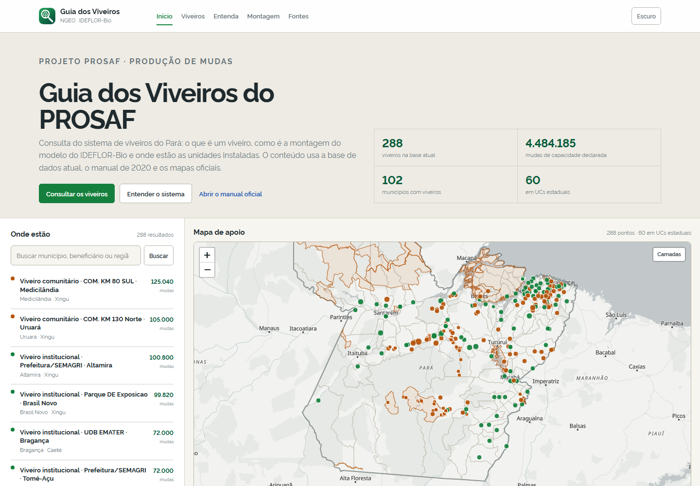
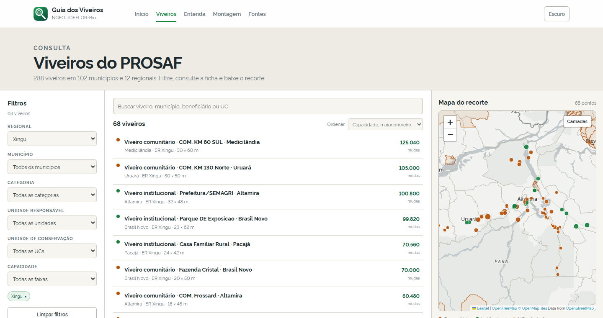
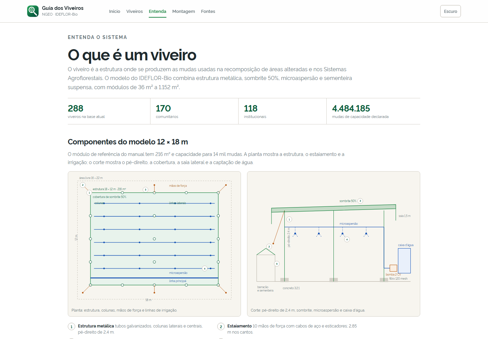

# Guia dos Viveiros do PROSAF

Aplicativo web de consulta do sistema de viveiros do **PROSAF**, desenvolvido pelo **NGEO** (Núcleo de Geoinformação) do **IDEFLOR-Bio**. O guia reúne a base de viveiros, o manual de montagem de 2020, os mapas oficiais e os documentos do projeto em uma interface de leitura e pesquisa.

**Acesse:** [https://ngeo-ideflor-bio.github.io/viveiros/](https://ngeo-ideflor-bio.github.io/viveiros/)

---

## O que o guia oferece

- **Home** com os números da base, busca, lista de viveiros e mapa de apoio.
- **Catálogo** com filtros por regional, município, categoria, unidade responsável, UC e faixa de capacidade. Lista e mapa sincronizados, ordenação, paginação e download do recorte em GeoJSON.
- **Ficha do viveiro** com capacidade, dimensões, área, unidade responsável, regional, região oficial do município, UC e coordenadas. A ficha abre em uma gaveta e tem URL própria.
- **Perfis por município e regional** com totais, divisão entre comunitário e institucional, lista de viveiros e mapa.
- **Entenda** com o papel do viveiro no PROSAF, os tipos de viveiro e um diagrama em SVG dos componentes do módulo 12 × 18 m.
- **Montagem** com as sete etapas do manual, ficha da montagem, lista de materiais e kit de ferramentas. A página tem uma versão de impressão.
- **Fontes** com os documentos oficiais, a metodologia do pipeline, os limites dos dados e os downloads.
- Tema claro e escuro, layout responsivo e mapa carregado sob demanda no celular.

---

## Capturas







---

## Dados

A base atual tem **288 viveiros** em **102 municípios** e **12 regionais**. A capacidade declarada soma **4.484.185 mudas**. Desses viveiros, **60 estão em 7 UCs estaduais**, sendo 40 na APA Triunfo do Xingu.

Os números da base não são os mesmos dos documentos oficiais:

- o mapa de 2021 lista 199 localidades;
- a base atual tem 288 pontos;
- a página do PROSAF menciona 250 ou mais viveiros;
- a página do PROSAF informa cerca de 4.011.040 mudas, enquanto a soma da base é 4.484.185.

Os recortes e as datas são diferentes. O guia apresenta os valores como capacidade declarada e mantém a data da base.

Outros pontos de curadoria:

- dos 46 pontos de São Félix do Xingu, 7 caem fora do polígono municipal na base atual;
- há uma coordenada duplicada;
- a base não traz nome próprio em todos os registros, então o nome de exibição é reconstruído a partir da categoria, do beneficiário e do município;
- a regionalização usada na base do PROSAF é a mesma dos mapas de 2020 e pode diferir de outras regionalizações do estado.

---

## Estrutura

```text
index.html                    aplicação
index-legacy.html             versão anterior, com Leaflet e filtro simples
assets/
  css/guia.css                design do guia
  js/guia.js                  rotas, catálogo, filtros, ficha, mapas
  data/
    viveiros.json             base normalizada e agregados
    municipios.geojson        municípios simplificados
    ucs_estaduais.geojson     UCs estaduais simplificadas
    regioes_integracao.geojson  regionais simplificadas
    estado.geojson            contorno estadual simplificado
  fonts/rawline/              Rawline local
  img/brand-mark.svg          marca NGEO
  vendor/
    leaflet/                  Leaflet local
    maplibre/                 MapLibre GL JS local
    maplibre-gl-leaflet/      ponte MapLibre e Leaflet
data/
  viveiros.geojson            base original
  municipios.geojson          base original
  ucs_estaduais.geojson       base original
  regioes_integracao.geojson  base original
  estado.geojson              contorno estadual original
scripts/
  build-guia.mjs              pipeline de dados e simplificação
```

A aplicação é um site estático com rotas em hash, sem build step. O mapa é um único mapa persistente, movido entre as páginas, com MapLibre GL para o mapa vetorial de base e Leaflet para as camadas de pontos e limites.

Os estilos do mapa de base vêm do OpenFreeMap (Positron e Dark), sem chave de API. A imagem de satélite é do Esri World Imagery. O mapa vetorial e as camadas de contexto são carregados sob demanda.

---

## Rodando localmente

O app precisa ser servido por HTTP. Não abra o `index.html` diretamente em `file://`.

```bash
python -m http.server 8000
# abra http://localhost:8000/
```

Também funciona com qualquer servidor estático.

---

## Regerando os dados

Pré-requisitos: Node.js 18 ou superior e `npx mapshaper` (o primeiro uso baixa o pacote).

```bash
# normaliza a base, calcula os agregados, simplifica as camadas e gera o sitemap
node scripts/build-guia.mjs

# apenas a base normalizada, sem rodar o mapshaper nem o sitemap
node scripts/build-guia.mjs --data-only
```

O pipeline:

1. lê os GeoJSON originais de `data/`;
2. normaliza capacidade, dimensões, municípios, beneficiários e unidades;
3. faz o join espacial com municípios e UCs;
4. calcula os agregados por regional, município, categoria, unidade e UC;
5. grava `assets/data/viveiros.json`;
6. simplifica as camadas de contexto com `mapshaper`;
7. atualiza o `sitemap.xml`.

Os arquivos originais de `data/` não são alterados. O download do catálogo usa a base normalizada e gera um GeoJSON de pontos.

---

## Versão anterior

O `index-legacy.html` mantém a versão anterior do visualizador, com Leaflet, Tailwind em runtime e filtro simples sobre os viveiros. Ela continua funcional para comparação, mas não recebe as melhorias do guia.

---

## Tecnologias

- Leaflet 1.9.4
- MapLibre GL JS 5
- mapshaper
- Rawline
- GeoJSON e SVG

---

## Licença

Desenvolvido pelo **NGEO / IDEFLOR-Bio / Governo do Estado do Pará**.
